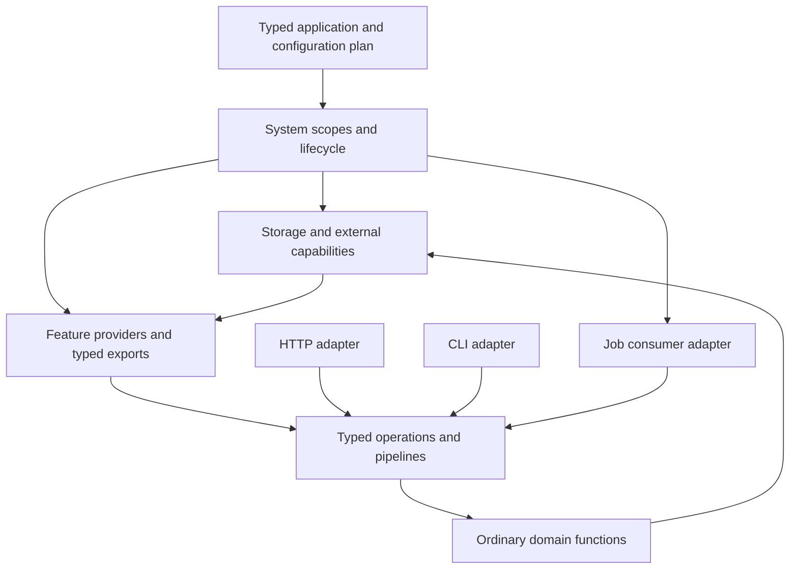

# Application framework: service-first design

Date: 2026-10-16. Status: draft 1. Accepted user decisions are identified explicitly; other decisions are selected design defaults for review. The framework APIs below are proposed. Existing-language examples and implementation evidence are identified separately.

This is the current authority for the framework proposal. [SPEC.md](SPEC.md) governs the language and runtime semantics; [ENHANCEMENTS.md](archive/plans/ENHANCEMENTS.md) (archived; leftovers in [BACKLOG.md](BACKLOG.md)) owned general ergonomic changes, including the provider/stage syntax. This design does not reorder the active compiler/runtime work queue.

## Accepted direction

The application framework will be an **extended core library** that makes applications and services easier to create. It will build on the language's existing systems/components, typed interceptor pipelines, scoped resources, tasks/channels, records, protocols, schemas, and errors.

It is intended to become the blessed way to build applications and services in this language. Design for a complete, coherent development experience: application setup, modular features, lifecycle, configuration, middleware, testing, scaffolding, and useful inspection. Include CLI applications and background services alongside HTTP applications.

**Accepted scope, 2026-10-16:** the first framework release is service-first: HTTP APIs, workers/durable jobs, and CLI entry points, with HTML and administration added later. Selected default: browser forms/session facilities arrive with that later web layer. The architecture should accommodate them without making them prerequisites for a useful service.

The user requested inspiration from:

- Erlang OTP.
- Elixir Phoenix.
- PHP Laravel.
- Rust Axum and Tower.
- Python Django.
- Ruby Rails.
- ClojureScript re-frame.
- Clojure Duct.

Co-design the framework with general language ergonomics using concrete examples. Record proposed language syntax in [ENHANCEMENTS.md, L8](archive/plans/ENHANCEMENTS.md#l8-streamline-provider-system-and-interceptor-declarations); keep framework conventions, packages, APIs, and delivery slices here. [Section 4 of the enhancement assessment](archive/plans/ENHANCEMENTS.md#4-framework-a-cohesive-application-service-stack) links the two workstreams.

## Inspiration and ideas to evaluate

These are selective adaptations to a statically typed native language, not commitments to reproduce every feature of each source framework. The linked primary documentation was checked for this brief.

| Inspiration | Relevant ideas in the source | Proposed application here |
|---|---|---|
| [Erlang OTP: supervision](https://www.erlang.org/doc/system/sup_princ.html) | Supervised children, restart strategies and budgets, ordered start/stop | Predictable managed-worker contracts, failure containment, bounded restart/escalation, explicit shutdown. Relate supervision to lifecycle dependencies while preserving their distinct responsibilities. |
| [Phoenix: contexts](https://hexdocs.pm/phoenix/contexts.html) | Named application contexts, domain APIs, generators that create related schemas and modules | Feature modules with small typed public interfaces; domain logic usable independently of transport; generators that create a working vertical slice and tests. |
| [Laravel: service providers](https://laravel.com/docs/12.x/providers) | Cohesive application bootstrapping, provider registration of services/routes/middleware, shared application facilities | One explicit composition root, useful provider conventions, compatible batteries, and a smooth setup experience. Express dependencies through typed system configurations. |
| [Axum: middleware](https://docs.rs/axum/latest/axum/middleware/index.html) and [Tower: services](https://docs.rs/tower/latest/tower/trait.Service.html) | Reusable service/middleware composition, documented ordering, readiness and backpressure | Typed handlers and reusable interceptor libraries with clear order, admission, deadline, and error contracts, usable across HTTP and other operations. Adapt these to ordinary suspending functions and structured tasks. |
| [Django: integrated facilities](https://docs.djangoproject.com/en/5.2/intro/overview/) | Cohesive data-access tools, URL dispatch, automatic model-based administration | A maintained application stack; evaluate schema-driven administration, data tools, and validation alongside routing. Specific persistence and administration APIs remain open. |
| [Rails: application conventions](https://guides.rubyonrails.org/getting_started.html) | Convention over configuration, application generators, coordinated resource/migration workflows | Predictable defaults and project structure; generators that connect interfaces, handlers, routes, migrations, and tests; explicit ways to inspect or override defaults. |
| [re-frame: effectful handlers](https://day8.github.io/re-frame/EffectfulHandlers/) and [data flow](https://day8.github.io/re-frame/flow-mechanics/) | Pure event/state transformations, effects/coeffects, a defined data-flow model | Explore typed events, explicit operation inputs, testable state transitions, and inspectable descriptions of requested effects executed by adapters. Keep concurrent ownership and module boundaries explicit. |
| [Duct: data-driven applications](https://duct-framework.org/) | Application structure/configuration as data; modules expand common setup into inspectable, overridable configuration | Typed application plans and reusable configuration modules, explicit profiles/dependencies, and inspection of the expanded effective plan before startup. |

Use the current Duct site as the starting point: the older `duct-framework/duct` repository identifies its Leiningen template as deprecated and points there. [Legacy template notice](https://github.com/duct-framework/duct/blob/master/README.md).

## Principles to carry into the design

1. **Typed modules with explicit dependencies.** A feature exposes an intentional public API and receives the capabilities it needs. The framework connects modules through checked system plans. Records of functions, nominal types, and protocols can each serve where appropriate.
2. **Lifecycle and failure are ordinary application concerns.** State who owns a resource/task, when it settles, how it closes, and what restart means for dependent components and pending callers. Keep expected errors, defects, and cancellation distinct.
3. **Reusable operation composition.** Request handling, commands, and jobs should share useful interceptor machinery. Preserve enter/leave/error traversal, prefix-visible context, separate replies, and scoped cleanup.
4. **Good defaults that remain inspectable.** Minimize repetitive setup while allowing users and tools to see dependency wiring, effective configuration, middleware order, operations, and error types.
5. **Easy isolated development.** Generated modules should have fake dependencies, focused tests, and clear integration points. LLMs should be able to query a feature's contracts and modify it without reading the whole application.
6. **A library that uses a strong language foundation.** Keep application policy in the extended core library. General-purpose syntax and runtime primitives should benefit other libraries too. Reuse the supported native-adapter platform and maintained implementations where appropriate.

re-frame's framework-level descriptions of requested effects are a separate concept from the language's inferred effect summaries. Exploring them does not itself introduce algebraic effect handlers or a new control-flow mechanism. Evaluate module-scoped state and managed worker ownership rather than assuming one global application database for concurrent services.

## 1. Product target and selected decisions

The first complete demonstration is an order-processing service. It accepts an order through HTTP or CLI, validates and authorizes it, commits local state, and queues a durable follow-up. A supervised worker delivers that follow-up to an external integration and records a confirmed, rejected, or uncertain outcome. Tests replace storage, identity, clocks, and the external integration with controlled implementations.

The application must remain easy to understand as it grows from one module to several. A developer or LLM should be able to add an operation by changing its feature, transport registration, and tests, with the compiler identifying affected consumers.

| Design question | Selected default |
|---|---|
| Distribution | A versioned, maintained extended core library, with optional batteries and native companions |
| Working namespace | `app.*`; package names and exact function signatures remain provisional |
| Application structure | Explicit composition root and feature modules with typed public interfaces |
| Dependency injection | Existing typed providers and system references; constructor/function injection within modules |
| Execution | Ordinary direct calls in the current task; explicit structured concurrency when needed |
| Common application boundary | A typed operation with inspectable identity, policy, input/output/error contracts, and an ordinary callable implementation |
| Interceptors | Existing typed pipeline semantics, reusable across transports where their contracts fit |
| State | Owned by a database, managed worker, or explicit synchronized capability; immutable values between operations |
| Persistence | SQL-as-SQL and typed repositories first; no mandatory active-record model or ORM |
| Events and effects | Optional pure decisions plus explicit effect adapters; ordinary functions remain the default |
| Background execution | Separate ephemeral workers, local bounded messaging, and durable jobs |
| Failure recovery | Restart suitable leaf workers; resource replacement/restart groups require explicit reconstruction rules |
| Configuration | Typed, validated inputs with explicit precedence and provenance |
| Tooling | One checked application description shared by CLI, LSP, MCP, generators, and inspection |

These defaults deliberately settle an initial direction; they can be revised with evidence from the vertical slices below. There is no claim that the proposed `app.*` modules exist today.

## 2. Architectural model

A system owns the application's resources and activities. Feature factories turn given capabilities into typed service interfaces. Operations compose those services with policies and interceptors. Transport adapters decode inputs and render outcomes.



An application is a checked composition of ordinary values. A component is a unit of acquisition/lifecycle. A feature module is a unit of source organization and public contracts. An operation is an application entry point. An actor/worker is a unit of owned execution/state. These roles can coincide in a small program, but the framework must not require them to be identical.

In particular, calling another feature's service is not implicitly a channel send, a task spawn, a transaction, or a remote call. Those behaviours require an explicit adapter.

## 3. Package and layer boundaries

| Layer | Responsibilities |
|---|---|
| Language/runtime and `std` | Types, effects, ownership/regions, scheduling, scopes, channels, collections, system/pipeline semantics, supported native boundary |
| `app.core` | Application description, operation descriptors, invocation metadata, registration and validation |
| `app.config`, `app.lifecycle` | Configuration loading/provenance, bootstrap/shutdown coordination, health and worker policy integration |
| `app.http`, `app.cli` | Typed transport bindings, request/argument decoding, response/exit rendering, route/command registration |
| `app.identity`, `app.policy`, `app.middleware` | Verified identities, authorization adapters, reusable policies and interceptors |
| `app.data`, `app.jobs`, `app.events` | Repository/transaction conventions, migration tasks, durable-job integration, optional typed decision/effect helpers |
| `app.observe`, `app.test` | Logging/tracing/metrics adapters, inspection descriptions, fixtures and application test clients |
| Optional extended packages | Database drivers, outbound HTTP, mail, cache/session stores, pub/sub backends, file storage, later web/admin facilities |

This is an ownership map, not a requirement to create one package per row immediately. The first library can group small modules. Users import the facilities they need; a CLI worker does not acquire an HTTP listener merely because the distribution includes HTTP support.

Use a matched framework release set and lock dependency content/native artifacts. Existing path dependencies are enough for the first slices. Registry distribution and git dependencies can follow the build-tool roadmap. Native adapters must use the supported FFI contract and preserve effects, authority checks, cleanup, inspection, and replay coverage; framework packages do not get implicit permission to bypass those facilities.

## 4. Existing support and actual gaps

| Foundation | Current support inspected | Framework work |
|---|---|---|
| Typed composition | `system`, providers, references, selection/replacement, scoped run | Application conventions, module descriptors, bootstrap validation and health coordination |
| Operation composition | `pipeline`, enter/leave/error, adapters, prefix-visible context | Standard operation envelope, policy library, useful inspection metadata |
| Concurrency | Scoped tasks, bounded channels, timeouts, worker policies and drain/cancel hooks | Consistent admission/deadline defaults, adapter cancellation contracts, service-level supervision conventions |
| HTTP | Handler/request scopes, finite and streamed replies, typed routes, URL/OpenAPI generation | Unified operation bindings, limits/order/error policies, test client and endpoint generator |
| Data | Typed codecs/schemas, SQLite APIs and typed SQL checks; native-library extraction is active | Repository/UoW conventions, migration commands, durable domain/outbox integration |
| Durability | `std.jobs` with leases/fencing, receipts, outbox outcomes and uncertainty | Typed application adapters, workflow versioning, testing and operational tools |
| Configuration | Manifest profiles, runtime settings, `config.load`/`from_env` | Explicit schema defaults, dotenv policy, secret handling and per-value provenance |
| Agent/editor tools | Checks, queries, graphs, diagnostics, REPL, LSP/MCP; source overlays and API documentation now have support in the checkout | Framework-aware context, semantic generators, application descriptions and contract-change guidance |

This is a source-inspection snapshot, not a new audit of those subsystems. The checkout is changing concurrently. Before implementing a slice, recheck its dependencies. Earlier findings in the enhancement assessment may already have been addressed.

The framework can begin using existing descriptor APIs. Provider/stage syntax sugar is an ergonomic improvement, not a prerequisite. No general macro system, custom derive evaluator, higher-kinded types, or algebraic effect handlers are required for this design.

## 5. Feature-module contract

A feature exposes a small typed interface and receives explicit dependencies. Its implementation is ordinary functions. Its provider acquires or adopts resources and returns that interface. Transport code lives beside the feature but depends on its public interface rather than its storage internals.

Recommended starting layout:

```text
src/main.bdg                  # composition root
src/orders/api.bdg            # public input/output/error/service contracts
src/orders/service.bdg        # domain/application implementation
src/orders/provider.bdg       # lifecycle integration
src/orders/http.bdg           # HTTP bindings, if needed
src/orders/cli.bdg            # CLI bindings, if needed
src/orders/jobs.bdg           # durable/worker bindings, if needed
src/orders/tests.bdg          # focused feature tests
```

Small pure features can use one file. Avoid generating empty files for unused capabilities. Reusable features can later move into packages with the same public interface.

The executable baseline uses these actual current-language contracts:

```badger fragment
pub type CreateOrder = { title: String }
pub type Order = { id: Int, title: String }

pub enum Error {
    invalid_title,
    unavailable,
} derive(Error)

pub type Store = {
    insert: fn(CreateOrder) -> Result<Order, Error> !{State},
}

pub type Service = {
    create: fn(CreateOrder) -> Result<Order, Error> !{State},
}
```

The in-memory baseline's `State` bound is intentional. A production repository performing I/O has a corresponding explicit effect bound; fakes conform to the selected public interface. Real domain errors should describe domain conditions, while an adapter maps driver failures into the chosen application error type with their cause preserved.

Public function-valued fields must have intentional effect annotations. Preserve lifetime and ownership information carried by captured dependencies. A nominal protocol-based interface is equally valid when its associated types or implementations are useful; the framework does not mandate a special service superclass.

A feature's descriptor records its stable name, source locations, public operation metadata, configuration schema, and optional transport/worker registrations. Dependency edges come from checked system references. The first generator emits explicit root-system entries; a homogeneous runtime list of differently typed feature exports is not the implementation model.

## 6. Application description and bootstrap

Use two phases: planning and running. Planning consumes explicit configuration and builds typed descriptions. Running acquires resources and owns activity scopes.

Planning validates unique feature/operation/route/command names, dependency edges, configuration, route conflicts, middleware requirements, policy combinations, queue capacities, and applicable schema compatibility. Type checking happens through the normal compiler. Values only knowable from a live resource are checked during acquisition and before readiness.

Startup sequence:

1. Resolve package/native-module identity and application configuration.
2. Validate descriptions and produce an inspectable effective plan.
3. Acquire providers in dependency order using `system.run`.
4. Start managed activities with explicit readiness checks and restart policy.
5. Open transport admission only after required dependencies are ready.
6. Mark the application ready and serve until shutdown or escalation.

No provider initializer runs simply to discover its type. Configuration expansion is an explicit bounded planning operation over given data; it cannot discover new static output types through environment-dependent execution. Ordinary `badger check` must not run arbitrary package initializers. Framework plan inspection either reads compiler-produced descriptions or uses a separately requested planning command with restricted capabilities and execution limits.

The initial composition root remains an ordinary `system { ... }`. A proposed `app.run` helper may combine configuration, signal handling, health, and `system.run`, but must preserve its callback-scoped resource contract. It cannot return a running service whose dependencies have already closed.

For example, a generated composition root could have this shape. The feature/adapter providers are application or future framework code; the `system { ... }` provider application and `ref` syntax itself is current language syntax:

```badger fragment
let plan = system {
    database: sqlite.pool({ path: settings.database_path }),
    store: order_store.provider({ database: ref(#database) }),
    orders: orders.provider({ store: ref(#store) }),
    routes: orders_http.provider({ orders: ref(#orders) }),
    server: web.server({
        address: settings.address,
        port: settings.port,
        handler: ref(#routes),
    }),
}
```

`order_store` adapts a concrete database into the domain's repository contract; `orders` does not depend on the database driver. `orders_http` binds the public operations to HTTP. A CLI entry can select the orders dependency closure and add a command binding while leaving routes/server unstarted. Generators and the proposed syntax improvements remove routine authoring work without hiding the expanded graph from inspection.

## 7. Operations and invocation metadata

Expose significant application entry points as typed operations. Keep internal calculations and helper functions ordinary functions.

Schematic proposed contract, not an implemented type declaration:

```text
Operation<Input, Output, Error, Eff>
    id: stable qualified symbol
    invoke: fn(Call, Input) -> Result<Output, Error> !Eff
    info: OperationInfo
```

`Call` contains small immutable invocation metadata: invocation/correlation identity, parent identity, optional absolute monotonic deadline, tracing information, and verified actor information when applicable. It is not a universal service container and does not carry an untyped bag of dependencies. Dependencies are captured by typed factories or supplied through specific parameters.

The operation wrapper establishes its current operation identity from its descriptor. Caller-supplied correlation labels cannot change the operation's policy, identity, or authority; nested calls retain a parent link and establish their own invocation identity.

`Call` is metadata, not a replacement for the runtime's cancellation or task scope. The current task and its owning scope govern cancellation. Work needing child tasks uses structured scopes. Streaming/scoped transport APIs retain their request-region types; they are not squeezed into an owned buffered-operation signature.

The initial implementation can wrap a callable and metadata in an ordinary generic record/struct. The callable must retain its effect and captured-region constraints. Do not claim that wrapping it in `Operation` makes it shareable or transferable. Moving it across a task boundary still requires the existing checks.

Input/output/error schemas are attached where a transport or durable boundary needs them. Pure internal operations do not all need `Codec`. Registered HTTP/job payloads must be encodable, validated, and free of escaping scope resources. Schemas and error mappings are checked against the actual generic operation type.

A proposed direct call looks like `orders.create.call(call, input)` and returns the concrete domain result. The exact method spelling is provisional. It runs in the caller's task unless the caller explicitly uses another execution adapter. Operation identity is useful for routing, logs, documentation, and tools; ordinary typed consumers do not dispatch through a string registry.

Do not try to store heterogeneous `Operation<I, O, E, Eff>` values in an implicitly erased list. Keep typed feature exports. A homogeneous metadata index can refer to them, and each transport binds a typed operation into its own uniform adapter representation. Explicit encoded boundaries handle heterogeneous wire data.

### Proposed authoring surface

Use distinct factories rather than implicit function/plan overloading: `operation.from_fn(info, callable)` for a callable and `operation.from_pipeline(info, plan)` for a pipeline whose input contains `{ call, input }`. Both expose the same typed operation contract. Metadata has stable identity/version and documentation; type/schema facts come from the actual callable/plan and explicit wire bindings.

This is a proposed library fragment, not runnable with today's imports. `Store`, `CreateError`, `validate_create`, and `can_create` are domain contracts/functions; `operation`, `validation`, and `authorization` are future library modules:

```badger fragment
fn build_operations(store: Store) {
    let create = operation.from_pipeline(
        { id: #orders/create, version: 1 },
        pipeline {
            validation.input(validate_create),
            authorization.require(can_create),
            handle(fn(ctx) -> Result<Order, CreateError> {
                store.insert(ctx.input)
            }),
        },
    )
    { create }
}
```

The private factory above illustrates inference; its exported counterpart declares a complete public API with the concrete operation error/effect parameters. `validation.input` transforms an input only under the pipeline's field-type preservation rule: use the same normalized type or establish a distinct decoded field. `authorization.require` checks the verified actor and typed input before invoking storage. It is a normal typed stage factory, not a policy registry lookup hidden in a symbol.

An HTTP binding might be `web.json_post("/orders", orders.create, { name: #orders/create_http, status: 201, errors: render_create_error })`. A CLI binding can connect the same operation to typed arguments/output/exit mappings. These constructor names/options are proposals. The binding factories check their input/output/error schemas against the operation; they do not reconstruct a service contract from strings.

The expected everyday experience is: implement a domain function, optionally compose typed policies around it, expose it through a small feature interface, and select adapters. The descriptor/metadata layer should not require a separate hand-written class, universal event type, or dependency-container lookup for each call.

## 8. Two levels of interceptor composition

Separate transport processing from domain operation processing so reply/error types stay coherent.

| Pipeline | Typical input | Typical successful reply | Responsibility |
|---|---|---|---|
| HTTP ingress | Scoped/owned request information | HTTP response or scoped stream | Request identity, tracing, limits, routing, protocol parsing and final rendering |
| Application operation | Typed input plus invocation context | Domain output such as `Order` | Identity/policy requirements, semantic validation, operation admission, domain work |
| Job consumer | Validated persisted envelope and claim | Typed job disposition | Lease/deadline handling, operation invocation, acknowledgement/retry/reconciliation |

A domain pipeline returning `Order` cannot recover with an HTTP `Response`. HTTP success/error rendering happens in the adapter or an explicitly adapted HTTP-shaped pipeline. This prevents transport types leaking into domain interfaces.

Recommended HTTP outer ordering: request identity and tracing; expected-error rendering; admission/deadline/body limits; routing and protocol decoding; operation invocation; response encoding. Authentication can precede expensive body processing where its credentials are available. Authorization requiring decoded resource identity follows decoding. Health endpoints have deliberately minimal policy and their own admission allowance.

At the operation boundary, policy protects all adapters, including CLI/jobs/direct application callers. Transport authentication alone must not be the only authorization check for a sensitive exported operation. Pure implementation helpers stay private when bypassing the guarded operation would violate its contract.

Preserve all existing pipeline rules: forward enter and reverse unwind; a stage joins the unwind stack only after successful enter; early stop does not invent later fields; recovery resumes earlier normal leave callbacks; each stage unwinds at most once; visible field types remain stable; earlier stages observe the latest values of their known fields. `handle_context` explicitly returns context updates when needed.

Pipeline error callbacks handle expected errors. Defects/cancellation go through task boundaries and deterministic cleanup. An HTTP boundary can contain a request defect and produce a generic failure before response commitment; it cannot promise to replace a response after bytes have been sent.

## 9. Middleware catalogue and composition rules

| Initial module | Contract |
|---|---|
| Request/operation identity | Validate or generate IDs; propagate trace links; bound untrusted header size |
| Observability | Time the operation, record structured outcomes, preserve context on early errors |
| Decode/validate | Keep syntactic/schema failures distinct from domain validation; bounded input and useful field paths |
| Identity | Verify credentials through an injected adapter; establish a typed principal |
| Authorization | Evaluate explicit policy for actor/resource/action; return a named denial |
| Admission | Acquire bounded concurrency/queue capacity, release exactly once after settlement |
| Deadline | Derive the earlier of configured and inherited deadlines; account for queue time |
| Error rendering | Apply transport-specific mappings without exposing internal messages by default |
| HTTP policy | CORS, response headers, compression, content negotiation and streaming-safe limits |

Later middleware includes rate limiting, cache validation, idempotency, circuit breaking, and retry. Each requires explicit policy/configuration rather than a default applied to every operation. Retrying a database read differs from retrying an external write whose outcome is uncertain.

Stage metadata should expose established/required fields, reply/error contracts, ordering requirements, effects, and source locations. Validate known incompatible arrangements during planning; preserve runtime checks where the composition is dynamic. General middleware should not inspect later-only context fields or stringify arbitrary application state.

Transactions normally wrap the relevant domain work using a scoped helper. Do not acquire a callback-local transaction during enter and let a later stage use it after that callback closes. A future transaction combinator must prove that its continuation remains inside the same resource scope, using the current language's checked callback machinery.

## 10. Error, defect, cancellation, and external uncertainty contracts

Each feature owns a concrete error enum. Direct callers receive that enum. The framework provides mapping protocols/helpers, not one mandatory universal application error union. Preserve wrapped causes and typed validation details.

| Outcome | Direct application caller | HTTP adapter | Worker/job adapter |
|---|---|---|---|
| Validation failure | Named error with field violations | Typically 400/422, stable public code | Reject invalid input; do not retry unchanged data |
| Unauthenticated/forbidden | Named policy error | 401/403 according to route policy | Fail the call or require an explicit service identity |
| Missing/conflicting entity | Named domain error | Usually 404/409 | Application-selected terminal or reschedule policy |
| Dependency unavailable | Typed adapter/application error | Usually 503, optional retry guidance | Bounded classified retry if the action is safe |
| Admission/deadline failure | Framework boundary error with reason | Usually 429/503/504 by cause | Remain queued or reschedule according to policy |
| Task defect | Explicit task boundary outcome | Generic 500 before response commitment | Supervision policy; never silently reinterpret as a domain success |
| Cancellation | Runtime cancellation outcome | End the request appropriately | Release/expire lease; follow durable operation state |
| Unknown remote-write outcome | Explicit durable uncertainty | Operation receipt/status or failure with reconciliation path | Reconcile; never blindly resend as an ordinary transient error |

These status mappings are overridable transport policy. The framework's public problem response should have stable code, safe message, invocation ID, and permitted field violations. Internal causes and stack/task details remain in authorized diagnostics. New mapping protocols can be ordinary implementations; custom derive support is not a prerequisite.

Contracts (`requires`/`ensures`) express programmer obligations. Failed contracts remain defects. User input validation must not depend on crashing a task because a caller violated a precondition.

## 11. Scopes, deadlines, admission, and cancellation

Application resources outlive their operations. Request scopes own per-request readers and child tasks. Transactions have their own shorter scopes and task confinement. The framework must preserve these relations through closures, operation wrappers, middleware, queues, and streaming adapters.

An inherited deadline is an absolute monotonic instant. A child can shorten it; nested helpers cannot extend it. Time spent in an admission queue consumes the same budget. Persisted jobs store wall/durable scheduling information and derive a fresh monotonic attempt deadline when claimed; do not persist an arbitrary process's monotonic clock origin.

Every public queue/limit states what is counted: waiting, admitted/executing, staged messages, leased batches, or retained streaming bytes. Configure both count and byte limits where payload size matters. Async diagnostic sinks use independent bounded budgets. Initial defaults must be explicit in generated configuration and later tuned from measurements; this document does not invent universal production limits.

Admission permits are released only after work using them has settled, including cleanup. Cancellation requests do not prove that a blocking/foreign call has stopped. Adapter contracts state when cancellation becomes effective and what can remain uncertain externally. Concurrency wrappers must not spawn closures that fail `Transfer` simply to impose a timeout on a task-confined transaction.

For multi-resource operations, define a consistent acquisition order or return a checked admission failure rather than wait while holding mutually dependent capacity. Do not claim that the type system proves arbitrary service graphs deadlock-free.

## 12. Shutdown, health, restart, and reload

Application shutdown has explicit phases:

1. Enter stopping state and become unready.
2. Stop new transport/job admission and detach external intake.
3. Drain admitted requests and designated workers within their budgets.
4. Cancel remaining work and wait for supported settlement/cleanup.
5. Halt dependent components before their dependencies; attempt all eligible cleanup.
6. Report the primary outcome with cleanup/escalation notes and final exit status.

Use an overall shutdown budget with subordinate budgets rather than extending shutdown indefinitely at each nested layer. If foreign work cannot settle safely, report/escalate according to the runtime contract; do not close a resource while it remains in use.

Liveness reports that the process can run its basic management loop. Readiness reports whether the selected externally served capabilities can accept work. Optional integrations can be degraded without making unrelated features unready. Health checks are bounded and do not perform writes merely to test connectivity. Readiness is not a substitute for admission control.

The first release supports independent worker restart through the existing factory/policy model. A factory recreates its own local state/resources on every attempt; it may capture longer-lived shareable dependencies. Restart does not replay an in-memory request or restore lost state. Escalation must visibly affect the owning component/application according to policy.

Resource replacement requires either a genuinely stable generation-aware interface or reconstruction of dependent closures. The selected initial policy for failure of a shared nonreplaceable resource is orderly application failure/restart. Later restart groups may rebuild the affected dependent closure after stopping admission and settling its work. Do not transparently point an old captured database handle at a new resource.

Retain the runtime's compatible function replacement contract for development. Changed interface/ownership/configuration contracts require rechecking and controlled reconstruction. Pure planning errors leave the current running application intact. OTP's restart strategies and intensity limits are inspiration, not a promise that every OTP strategy is already implemented here. [OTP supervision](https://www.erlang.org/doc/system/sup_princ.html).

## 13. Configuration and secrets

Selected precedence, lowest to highest:

1. Explicit typed framework/feature defaults.
2. Base application TOML values.
3. Selected profile values.
4. Development dotenv values, only when explicitly enabled.
5. Process environment values.
6. Explicit CLI/application overrides.

Resolve configuration at the composition boundary. Imports and feature constructors must not read ambient environment variables secretly. Maintain separate namespaces for runtime settings and application settings. Environment key mapping uses an explicit application prefix and unambiguous nested-path separator; exact spelling is part of the configuration API slice.

Merge schema-defined object fields recursively, replace lists as whole values, and treat maps according to their declared key schema. `null` is valid only where the target permits absence. Reject unknown schema keys and invalid overrides; do not silently fall back to a lower-precedence valid value. Distinguish explicit deletion/absence from a missing override before supporting deletion syntax.

Return provenance by field path: source, source location/key, selected value or redaction, and overridden sources. Pure schema/domain validation runs before acquiring dependent resources. Connectivity and live schema compatibility checks happen after acquisition and before readiness.

Use explicit secret-bearing types/adapters with redacted ordinary display/inspection and no accidental wire encoding. Secret material is revealed only to the capability that needs it. Secret rotation is an explicit later lifecycle feature, not a mutable global variable. Changing configuration can either be a compatible operation on an existing interface or require reconstruction; the descriptor must state which.

Duct's inspectable expansion of reusable configuration is a useful model. Framework modules should expand common setup into a typed effective plan that can be inspected and overridden through checked inputs. [Duct application descriptions](https://duct-framework.org/).

## 14. HTTP and CLI bindings

An HTTP endpoint binds method/path/name, typed path/query/body schemas, an operation, success rendering, expected-error mapping, and transport policies. Derive URL construction and OpenAPI from the same registration. Validate route/name conflicts before opening the listener. The current `std.route` module is a starting point, not a parallel routing system to discard.

The adapter parses bytes into typed input; builds verified call metadata; invokes the operation; renders its concrete result. Preserve distinctions between malformed input, missing fields, invalid values, and authorization errors. Allow explicit versioned wire schemas whose field names can differ from language identifiers.

List/query endpoints should use explicit bounded pagination and allowlisted filters/sort keys. Prefer a stable cursor/keyset contract where the store supports it; cursor tokens include the relevant ordering/query identity and cannot silently authorize a different tenant/query. Maximum page sizes are part of the operation contract. The framework does not turn arbitrary request field names into unchecked database expressions.

Finite replies own their data. Streaming replies use a separate checked request-scoped API with bounded buffering, disconnect cancellation, and cleanup after consumption. Do not erase a scoped body reader into the generic owned-operation registry. SSE/WebSocket packages can build on the transport foundation later; their full protocol support is not a prerequisite for the first service slice.

Verify admission and input limits at the actual transport boundary. A body-reader API over an already-buffered request is not proof of incremental upload streaming, and rejecting an oversized body after buffering it is not a memory bound. F05 must exercise headers, slow uploads, concurrent connections, disconnects, and native-adapter cancellation before those guarantees are advertised.

A CLI command binds a stable command name, typed arguments/options, an operation, output rendering, and error/exit mapping. It selects only the required system dependency closure. A maintenance command should not start the HTTP server by default. Interactive prompts and shell completion are later conveniences over the same command schema.

The framework's endpoint has a lifecycle role as well as a request adapter role, following the useful separation in [Phoenix.Endpoint](https://hexdocs.pm/phoenix/Phoenix.Endpoint.html). It must not make request handlers responsible for starting shared application resources.

## 15. Identity, authorization, and external authority

Authentication adapters create verified identity values with private construction. Sensitive operations declare the policy they need and take the verified principal/context explicitly. Callers cannot gain system authority by supplying a string such as `"admin"`. Background jobs and CLI commands have explicit identities/capabilities rather than implicit unrestricted access.

Resource-specific authority lives in typed dependencies: a directory capability, origin-bound HTTP client, repository API, or restricted process runner. Broad `Io`/`State` effects are useful summaries but do not prove permission to touch a particular tenant, file, host, or database row.

Use the current restricted-project model at the composition boundary, and track its limitations. Its existing entry-module rule can constrain moving all acquisition into a separate bootstrap module; framework extraction must preserve the restriction or deliberately extend it with a checked composition-root contract. Do not bypass it with reflection or mark every framework helper as trusted ambient authority.

Session/cookie-based browser authentication, CSRF protection, and admin permissions belong in the later web layer. Select maintained credential/crypto implementations through the supported native/library boundary; the framework should supply contracts and integration rather than new cryptographic primitives.

## 16. Persistence, transactions, and migrations

Use typed repository capabilities and SQL-as-SQL as the first persistence convention. Preserve the option to write a feature against a fake or different store. The framework does not require every data type to be a database model or every operation to own a transaction.

Transactions are explicit scoped helpers around application work. Multiple repositories participating atomically receive a shared transaction/unit-of-work capability from the same owner; repository methods must not secretly open independent transactions. Nested transaction behaviour must be declared as savepoint, reuse, or unsupported, rather than inferred from call nesting.

Preserve the helper's complete result, including commit/rollback failures. A response indicating committed success is not emitted from inside a callback whose commit has not yet happened. A transaction cannot roll back an already-issued remote request.

Migrations are named, versioned, explicit application tasks with checksums, locking, status, and failure reporting. The default server startup checks compatibility and refuses readiness for an incompatible schema; it does not silently apply destructive schema changes. Migration fixtures must run against the selected driver and include the necessary rollback/forward-only policy.

Provide `after_commit` convenience only with its exact guarantee stated: a callback scheduled in memory can be lost after commit if the process crashes. Use a transactionally persisted outbox when delivery must survive that gap. Django documents that post-commit callbacks are outside the transaction, while Laravel provides commit-aware queue dispatch; these motivate making both timing and durability explicit. [Django transactions](https://docs.djangoproject.com/en/5.2/topics/db/transactions/), [Laravel queues](https://laravel.com/docs/12.x/queues).

The existing job store and the domain database may be different databases/connections. Their writes are not automatically atomic. A domain-outbox adapter must share the actual transaction or define a recoverable bridging protocol. Driver/package extraction is active work; this design does not assume a transaction adoption API already exists for every adapter.

## 17. Pure decisions, events, and effects

Offer an optional re-frame-inspired functional core for operations whose state transitions benefit from it. A pure function consumes an explicit state snapshot, input, and needed coeffects such as a supplied timestamp; it returns a decision containing next state, domain events, and requested commands.

Schematic proposed library shape:

```text
decide(State, Input, Coeffects)
    -> Result<{ state: State, events: List<Event>, commands: List<Command> }, DomainError>
```

`Event` and `Command` are ordinary application enums. Events record facts; commands request work through a typed interpreter/capability. The framework does not need a universal dynamic event map, a new effect keyword, or one global mutable application database.

For durable use, load/version the state and commit the chosen state/events/outbox commands under an optimistic version check or another explicit serialization rule. Rerunning a pure decision after a version conflict is different from retrying an already-issued external command. Persisted command payloads have versions, stable identities, and bounded encoding; live closures and scoped resources cannot be serialized into jobs.

Direct synchronous functions remain the recommended path for simple operations. Add the decision/interpreter abstraction where it improves testability or inspection, rather than wrapping every function in an event bus. This adapts re-frame's explicit inputs and effect descriptions to service ownership and durable boundaries. [re-frame effectful handlers](https://day8.github.io/re-frame/EffectfulHandlers/).

## 18. Workers, jobs, messaging, and scheduling

| Mechanism | Intended use | Failure/delivery contract |
|---|---|---|
| Scoped child task | Concurrent subwork of one request/operation | Ends within the owning scope; explicit join/error coordination |
| Managed worker | Long-lived activity or owned local state | Restartable factory and explicit drain/cancel/escalation policy |
| Local channel/pub-sub | Bounded communication inside one process | No crash durability; capacity, close, ordering, and slow-consumer policy are explicit |
| Durable job | Work surviving process restart | Versioned payload, attempts/backoff, lease/fence, acknowledgement and inspection |
| Durable external command | Side effect requiring receipt/reconciliation | Stable key, persisted dispatch state, confirmed/rejected/not-sent/uncertain outcomes |

Build application jobs on `std.jobs` instead of creating a second durability engine. Separate retry classification from worker restart policy: a worker can restart while a claimed operation remains uncertain and must not be repeated.

An actor helper can use a typed message enum, bounded channel, and owned state, with optional one-shot replies and sharding. It is a library pattern; a new actor/receive keyword is unnecessary. Document a single serial actor's throughput limit and preserve per-key ordering when sharding is requested.

Scheduled work should distinguish a local timer from durable scheduling. The durable scheduler needs explicit missed-run, duplicate, overlap, and timezone/DST policies before calendar scheduling is advertised. Start with persisted due times/intervals and UTC; avoid a superficially convenient cron API with unspecified restart behaviour.

Pub-sub must define what happens to slow subscribers: block, reject, disconnect, or drop with reporting. Durable integration events need durable storage/acknowledgement; an in-memory broadcast is not that guarantee.

## 19. Idempotency and external-effect receipts

Make idempotency an explicit operation policy where required. Scope its key to the operation/version and relevant actor/tenant boundary. Associate the key with a normalized input fingerprint; reusing it for different input is a conflict.

For a local transactional mutation, persist the key, domain result, and necessary outbox work atomically. Concurrent duplicates observe one committed result or a declared in-progress disposition. Define retention and compatibility when operation schemas change.

External writes require a persisted attempt record before dispatch. A network timeout or process death after dispatch can leave the outcome uncertain. The framework must expose a receipt/status and reconciliation path, not automatically label the attempt safe to retry. Idempotency support at the destination can help, but its contract must be known to the adapter.

This is a focused extension of the existing jobs/receipts model and the [real-world integration direction](REAL_WORLD_USE.md). Journaling, operation IDs, or scheduler replay alone do not create exactly-once remote effects.

## 20. Observability and application inspection

Share stable invocation, feature, operation, route, worker, job, and provider-generation identities across logs, traces, metrics, errors, and receipts. Track queue wait separately from execution and cleanup time. Bound metric label cardinality; do not use arbitrary input, user IDs, or full URLs as metric labels by default.

Diagnostic logging/OTel export must have bounded sinks, explicit overload reporting, and defined flush/shutdown behaviour. A durable audit record is business data and needs its own fallible persistence contract; it must not silently inherit a trace sink's drop policy.

Expose a versioned static application description: public operations and schemas; provider/dependency graph; route/command/job bindings; middleware order/contracts; configuration schema/provenance with redaction; health requirements and worker policies; source locations and dependency versions.

Expose live snapshots separately: readiness/stopping state, provider generations, active invocations, queued/admitted work, task waits, job leases/outcomes, diagnostic losses, and code version. Snapshots are observations, not globally atomic truth across all workers unless explicitly implemented.

API lookup and framework inspection should work without evaluating arbitrary domain code or contacting production dependencies. Remote eval has a different authority profile from read-only inspection and must remain distinguishable in tooling and configuration.

## 21. Testing and fixtures

Give every feature factory a fake-dependency path. Test pure domain decisions without a running system; test its service interface with fakes; then test real adapter contracts and complete lifecycle behaviour independently.

Framework fixtures should provide a selected system dependency closure, typed provider replacement, controlled clocks/randomness, in-process HTTP/CLI/job clients, ephemeral databases, and bounded scheduling exploration. Every fixture owns cleanup and isolates mutable state. A fake must satisfy the public contract and should share a driver contract suite where feasible.

Initial required scenarios: success, invalid input with no mutation, policy denial, transient dependency failure, startup failure after partial acquisition, request cancellation, overload, worker escalation, commit failure, uncertain external outcome, shutdown with in-flight work, and restart/replay of durable state.

Tests that always roll back transactions do not exercise actual post-commit callbacks or committed outbox dispatch. Include real-commit fixtures and process-crash/reopen tests for those guarantees. Controlled scheduler exploration and external-I/O replay have distinct coverage; neither proves exhaustive arbitrary multicore correctness.

Record structured failures, source locations, seeds/decisions, source/config identity, and reproduction commands. Suggested affected tests from call/module graphs improve iteration, while final verification still includes relevant integration and lifecycle checks.

## 22. Scaffolding, LSP/MCP, and LLM workflows

Proposed commands should be implemented through shared semantic services, not independent string-rewriting scripts:

```text
lang new service NAME
badger generate module FEATURE
badger generate operation FEATURE.OPERATION
badger generate endpoint FEATURE.OPERATION
badger generate worker FEATURE.WORKER
badger generate interceptor NAME
lang app describe PATH --json
lang app check PATH --json
```

These are proposed commands. Existing `badger check/test/query/inspect/graph/doc` remain the current mechanisms; final command organization can use those existing verbs where clearer.

A module generator creates the public contract, implementation factory, provider, fake, tests, and explicit composition registration. An endpoint generator binds an existing typed operation, generates transport mapping/schema tests, and updates route registration. A worker generator asks for ownership, queue/durability, restart, and shutdown policy. Generate named incomplete implementation sites rather than fabricated successful business results.

Preview edits against source hashes; check multi-file overlays before application; format canonically; report touched symbols, remaining choices, and verification. Stable operation IDs have explicit renames/aliases when persisted or externally exposed. A source rename must not silently change a durable job kind or public wire contract.

Useful framework queries include: what dependencies/policies does this operation require; which adapters call it; which stage establishes a missing field; how does this provider halt; what changes if this error/schema changes; which tests use a fake versus a real driver; what does this configuration override change? Return bounded context with current snapshot identity and links to authoritative APIs/examples.

A normal LLM task should follow one small loop: query a feature's contract/context; generate or edit ordinary code; check proposed files; run focused contract tests; inspect the resulting application-plan diff. Compile/test evidence must remain separate from a claim that the business requirements are complete.

## 23. Language and compiler interaction

Provider/stage declarations and shorter system entries are implemented (spec chapter 06): `provider NAME(scope, config) -> Result<O, E> { ... }`, `stage NAME(params) -> Result<_, E> { enter(ctx) { ... } ... }`, and `key: provider(config)` entries. They desugar to the existing typed descriptors and keep diagnostic/source identity (`#module/name`, or `as #label`); a stage's shared `-> Result<_, E>` annotation replaces the repeated callback annotations.

The framework also benefits from fallible pipes, expression lambdas, pattern conditions, fallible collection helpers, richer diagnostic/query parity, and reliable semantic edits. Those remain general enhancements with independent value to non-framework code.

Public framework interfaces should use existing generic/effect/region machinery. Prototype the operation wrapper and scoped adapters early. If a callable wrapper loses capture-region/effect information, fix that general checker gap rather than authorizing the framework to erase it. Buffered operations should not require unrestricted higher-rank inference; use the existing checked scope-helper patterns for streaming/resource callbacks.

Only add compiler hooks for a demonstrated general requirement. Schema derivation is currently compiler-supported; custom derives and arbitrary compile-time code are not prerequisites for routing, configuration, inspection, or generators.

## 24. Executable baseline and its limits

[examples/design/framework](examples/design/framework/README.md) is a current-language prototype accompanying this design. It contains public feature contracts, an injected isolated fake store, typed provider values/configuration, validation and audit interceptors, explicit lifecycle logs, and a worker-policy example.

```text
target/release/badger check examples/design/framework
target/release/badger run examples/design/framework
target/release/badger test examples/design/framework --json
```

The service normalizes a title, persists an in-memory order, and exposes the public interface through a system. Its audit stage observes the validator's update to an established context field. Startup and shutdown logs establish dependency ordering, including partial-start and operation-error cleanup cases.

Seven accompanying tests exercise fake-backed creation, validation with no store write, fake isolation, normal lifecycle ordering, partial-start cleanup, operation-error cleanup, and a bounded worker-factory retry. This validates composition on the available release executable. It does not implement `app.*`, a server, durable storage/outbox, authentication, deadline/admission machinery, full crash recovery, or the framework's eventual streaming/scoping contract.

Verification on 2026-10-16: `badger_cli 0.1.0` from the available release executable checked and ran the restricted-mode project, its seven tests passed with the default one worker and with `BADGER_WORKERS=4`, and its sources passed canonical formatting checks. No fresh compiler build or full repository test run was performed for this design task; compiler/runtime/native-adapter work was changing concurrently.

The existing [HTTP/SQLite service](examples/design/service/src/main.bdg) is another useful baseline for transport and transactions. Keep its tested implementation claims separate from new framework proposals and active native-adapter extraction.

## 25. Delivery slices and acceptance proof

Every slice should leave a runnable application and a visible inspection/test result. The final release is service-first, but the first slice can be an in-process service so composition remains easy to verify.

| Slice | Runnable demonstration | Acceptance proof and dependency |
|---|---|---|
| F01: typed feature baseline | Current-language order module with fake storage and providers | Accompanying example passes its seven tests; explicit effects and public types; no new framework primitives |
| F02: operation/core contract | Same feature exposes an inspectable typed operation; direct caller and fake tests | Input/output/error/effect/capture constraints preserved; heterogeneous metadata index does not erase direct-call types; forged/incomplete registrations rejected |
| F03: bootstrap/config/health | Configured CLI application starts selected dependencies and reports readiness | Precedence/provenance tests; unknown keys fail; startup failure cleans up; metadata planning acquires no resources; restricted-project acquisition remains checked |
| F04: HTTP/CLI bindings | Create/query order through both transports using one operation implementation | Same domain contract; typed decoding, URL/OpenAPI/command schemas; explicit error/exit mapping; cancellation and response-commit rules covered |
| F05: identity and admission | Protected endpoint under controlled overload and deadlines | Invalid identity/policy cannot reach mutation; inherited deadlines include queue time; permits/bytes reclaimed after cancel/failure; request/body/header limits exercised |
| F06: SQL and migrations | Replace fake store with a native-driver-backed repository; run migration task | Shared repository contract suite; real commit/rollback failures; scope escape rejects; server refuses incompatible schema; native adoption/authority contract verified |
| F07: supervised worker/jobs | Durable follow-up survives worker and process failure | Lease/fence/backoff/version tests; local worker restart distinct from job retry; drain/cancel/escalation visible; no false durability from in-memory queues |
| F08: transactional outbox/receipts | Persist domain change and follow-up; destination success, rejection, and unknown outcome | Real shared-transaction integration or explicit bridge protocol; duplicate-key conflicts; crash windows and reconciliation; no blind resend of uncertain effects |
| F09: pure decision/event helpers | Order transition produces typed events/commands under controlled coeffects | Pure tests; version-conflict recomputation; durable adapters execute only committed commands; ordinary direct functions remain usable |
| F10: generators and agent integration | Add a feature/endpoint/worker using compiler-backed templates | Overlay check, plan diff, semantic registration, fresh-source preconditions; generated tests and focused context queries; no fabricated complete business implementation |
| F11: operational hardening | Run the complete service with slow consumers, failures, reload and shutdown | Bounded resource measurements, multi-worker/fuzz/simulation coverage, trace loss visibility, independent request failures, live inspection; restart-group support only with safe reconstruction proof |

### Status (2026-10-18)

Each slice has a runnable demonstration in the checkout (`examples/framework` unless noted); what is left is listed with it.

| Slice | Implemented | Tests | Left for later |
|---|---|---|---|
| F01 | Descriptor baseline | `examples/design/framework` (7 tests) | — |
| F02 | `std.app`: `Operation` (built only by `from_fn`/`from_pipeline`, E0315 otherwise), `Call` (correlation, parent, deadline that only shortens, actor), `index` | `tests/run/app_operations`, `tests/reject/app_operation_forged` | — |
| F03 | `config.resolve`/`resolve_or` (defaults < `[config]` < profile < env < overrides, strict, per-setting provenance), `config.Secret` (redacted in display, JSON, provenance), `app.Health`/`app.check`, `app.run` (ready after startup, stopping before halt, stopped after), `endpoint.health` | `config_resolve`, `tests/run/app_health`, `tests/reject/app_run_escape` | Dotenv values are reported as environment values; secret rotation; compiled binaries report profile values as `[config]` |
| F04 | `std.endpoint` (`bind`: typed params/body/reply, explicit error mapping, correlation, OpenAPI summary), `std.command` (`bind`, `run`, `main`, exit statuses) | `tests/run/app_bindings`, `framework_example` | Streaming endpoints over operations; OpenAPI error responses (the mapping is a function) |
| F05 | `std.admission` (native gates: FIFO hand-off, queue-time deadlines, release after settle/cancel), `app.guard`/`require_role`, `endpoint.bind_in` (bearer identity, timeout from arrival, gate, body limit) | `tests/run/admission_gate`, `tests/run/app_admission` (4 workers, chaos) | Byte budgets (gates count calls); sessions and external identity providers; transport limits stay the HTTP server's |
| F06 | `sqlite.migrate`/`schema`/`require_current` and the same for Postgres (checksummed, one transaction each, re-checked inside it; Postgres takes an advisory lock); SQLite repository with a shared contract test | `tests/run/sqlite_migrations`, `tests/postgres/migrations` (live server), `framework_example` | Units of work spanning repositories |
| F07 | `jobs.store` provider, `jobs.process_one`/`processor` (handler error = job retry; defect = worker restart; lost claims given up) | `tests/run/jobs_worker` | Drain policies beyond the worker's shutdown policy |
| F08 | `jobs.attach`, `jobs.submit_in` (domain change and job in one transaction), `jobs.dispatcher` | `tests/run/jobs_outbox` (crash mid-send → uncertain, no resend, reconcile) | Postgres-backed job store |
| F09 | `std.decide` (pure `!{}` deciders with coeffects, optimistic `execute` that decides again after a conflict, `memory` stream) | `tests/run/decide_orders`, `tests/reject/decide_impure` | A durable event-stream adapter |
| F10 | `badger generate feature` and the MCP `generate` tool (checked and tested in a copy of the project before writing; never replaces files) | `generate_feature`, `mcp_tools` | Endpoint- and worker-only generators; semantic plan diffs beyond the file list |
| F11 | The composed service under concurrent gated writes, malformed/oversized requests, a slow client, live inspection, and SIGINT shutdown | `framework_service` (service.rs) | Restart groups; long-running soak measurements |

Native modules, library extraction, and runtime fixes continue under their existing owners. F06/F08 need explicit integration gates rather than assuming the database and job-store connection models already compose atomically. Syntax sugar can land alongside these slices after equivalent-desugaring tests; the baseline must keep working without it.

## 26. Deliberate deferrals and decisions still needed

HTML/templates/forms/browser sessions/admin are accepted later scope. Other follow-ups include a full ORM, reactive browser UI, distributed actors/service discovery, arbitrary dynamic middleware that changes unknown context shapes, automatic distributed transactions, and transparent remote calls. These are not needed for the first service release.

The main remaining design choices are narrower than the original brief:

- Final operation/call type spelling and callable-wrapper representation, validated in F02.
- Exact per-adapter default limits and shutdown budgets, selected from workload measurements.
- Identity/session provider implementations and the initial external authentication integration.
- Driver-supported unit-of-work/outbox composition, job schema migration, and receipt retention policy.
- Native adapter packaging/version compatibility and the extension of composition-root authority checking, if required.
- Restart-group reconstruction interface and which resources can support stable generation-aware handles.
- Generator template format and how reusable configuration modules expose checked overrides.

Keep a decision log as those slices provide evidence. The accepted service-first scope, extended core placement, explicit dependency/lifetime contracts, and user's interceptor context semantics remain the governing constraints.
