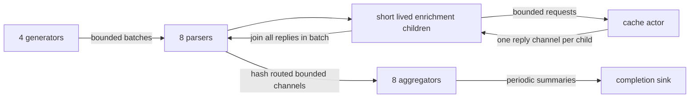

# Concurrent Telemetry Indexer

This application benchmark runs compiled `.lang` code against the project's actual
task scheduler, collector, and typed channels. It complements the small channel
and spawn benchmarks with a complete, deterministic ingestion service. It makes
no external network, filesystem, timer, or random-provider calls inside the timed
pipeline. `task.yield_now()` models an asynchronous cache boundary.



## Run and verify

Run from this worktree, using its own compiler build and target directory:

```sh
cargo build --release --offline
python3 -m unittest discover -s bench -p 'test_telemetry.py'
python3 bench/telemetry.py --smoke --out /tmp/telemetry-smoke
python3 bench/telemetry.py --workers 1 2 4 8 --out reports/telemetry/run
```

The smoke suite checks partial batches, more generators than batches, empty
shards, capacity-zero rendezvous channels, per-event enrichment, summary rollover,
and final draining on 1, 2, and 4 workers. The normal runner executes one warmup
and three measured fresh processes for every profile and worker count. Case order
is shuffled reproducibly each round; warmups and optional instrumented passes are
excluded from the reported medians. Every process starts with an empty cache and
fresh runtime pools; the separate warmup primarily warms host/compiler caches. It writes JSON with every raw run and a
Markdown report. A `.partial.json` checkpoint survives failure. Each process has
a deadline and its process group is killed on timeout.

`--lang /absolute/path/to/lang` selects a different build for a revision comparison.
Run the same runner, workload, config, and host conditions against both builds.
The report records the executable hash, workload/runner hashes, checkout revision
and dirtiness, CPU model, allowed CPUs, exact configs, and run order. The revision
identifies the harness checkout; the executable hash identifies the selected
build. Build provenance for an external `--lang` binary must be recorded by the
caller. All inherited `LANG_*` instrumentation/configuration variables are removed.

For a performance run, finish other builds and test runs first. Use the same CPU
affinity, governor/power settings, and machine load for comparisons. For example,
`taskset -c 0-7 python3 bench/telemetry.py ...` inherits affinity into the children.
There is deliberately no absolute throughput pass/fail threshold.

## Fixed work across worker counts

| Parameter | Default | Purpose |
|---|---:|---|
| Events | 65,536 | Finite, drainable run; increase for steady state |
| Generators | 4 | Concurrent producers, deterministic striped batches |
| Events per batch | 64 | Bounded fan-out and memory retention |
| Parsers | 8 | MPMC ingestion; fixed during a scaling sweep |
| Ingestion capacity | 128 batches | Admission backpressure |
| Enrichment interval | 8 events | 12.5% request rate |
| Cache request capacity | 128 | Many children contending on one actor |
| Cache miss yields | 1 | Extra scheduler boundary for first access to a key |
| Aggregators | 8 | Hash-routed MPSC channels |
| Aggregator capacity | 256 events | Per-shard backpressure |
| Summary capacity | 16 | Active sink must drain concurrently |
| Summary interval | 10,000 events/shard | Full and final partial flushes |
| Latency sample interval | 16 events | Bounded histogram overhead |
| Hash rounds | 1 | FNV-1a over all 256 payload bytes |
| Seed | 20,261,016 | Explicit U64; independent of scheduling |

`--events`, `--parsers`, `--sample-every`, and `--seed` override these values.
`--workers` changes only scheduler workers. Keeping parsers fixed prevents a
scaling result from quietly changing the task graph and maximum in-flight work.
Use `--parsers 32` for a separate 2×16-core parser experiment, for example.
Worker counts above the allowed CPU count are oversubscription experiments and
should be described as such; the runner records affinity rather than pinning it.

The complete configuration can also be passed directly to the program as a JSON
object in `TELEMETRY_CONFIG`; all fields are required and listed in `Config` in
`telemetry.lang`. The runner owns this variable for its child processes. Zero
capacities select rendezvous behavior and are exercised in smoke tests. Counts,
intervals, and CPU rounds must be positive; shards must be at most 512.

## Work performed

Each event has an ID, a source IP key, and its own contiguous **256-byte payload**.
The current runtime stores array elements as machine words, so the payload is
represented by 32 `U64` elements. Generation uses per-event XorShift64 state seeded
through a SplitMix64 mixing step. Parsing extracts all eight bytes from each word
in a specified little-endian order and runs FNV-1a. This avoids accidentally using
2 KiB per `Array<Byte>` payload. Payloads are generated during the measured run;
no precomputed payload/hash tables remove the CPU or memory work. Actual hashing
cost is a measured property of this compiler/runtime; no 100–300 ns assumption is
made. `hash_rounds` changes the amount of CPU work without changing task topology.

IDs and payloads are invariant under generator scheduling. A deterministic hash
chooses an 80% 64-key hot set and a 20% disjoint 4096-key cold set. Selection for
enrichment uses `id % enrich_every == 0`; the default rate is exactly 12.5%, with
ceil rounding on a partial workload.

For each batch a parser hashes the events, spawns all selected enrichment children,
then joins every reply before routing events. Each child creates a capacity-one
prompt channel, sends a request to the cache actor, and waits for its reply. This
is a one-use RPC channel built from the runtime's normal channel API. The actor
owns a real persistent hash map of tags/access counters, updates it on every
request, yields once per request, and yields `miss_yields` extra times on a first
access. Tags depend only on source IP; cache misses equal distinct requested keys.
This is a bounded-key cache, with no eviction policy. One actor deliberately
exposes a serial service bottleneck; its limit must not be attributed entirely to
the scheduler.

Each batch has a nested task scope. Completed children, reply channels, and join
handles therefore do not accumulate across the whole stream. Each aggregator
maintains current and previous count maps, rotates them every summary interval,
and counts alerts when a key's two-bucket total reaches 32. This is an event-count
window approximation, not an exact time-based sliding window. Summary intervals
and alert counts depend on event arrival order; checksum/count correctness does
not. Both maps have bounded key cardinality. `max_window_keys` is the sum of the
two map sizes (overlapping keys are counted twice).

The completion sink is a concurrently running task and retains only one total
per shard. After generators join, ingestion closes and drains. After parsers
join, cache and shard inputs close and drain. Aggregators emit final partial
summaries, then the sink input closes and drains. A task defect propagates through
its scope; unexpected closed channels fail the run. No sleep or unbounded queue
is used to mask deadlocks.

## Profiles

| Profile | Change from balanced | Question |
|---|---|---|
| `balanced` | Defaults | Combined CPU, memory, maps, task churn, and routing |
| `backpressure` | All four queue capacity classes become 1 | Full/empty wakeups and downstream pressure |
| `fanout` | Every event enriches; 4 miss yields | Child allocation/teardown, fan-in, actor saturation |
| `cpu` | 8 hash rounds | Whether extra useful CPU work improves scaling |

Use `--profiles balanced backpressure` to select a subset. Each profile's one-worker
run is its own throughput baseline; speedup and efficiency are omitted when a
sweep does not include one worker. These are saturation/closed-loop workloads:
bounded backpressure slows sources. Their latency distributions describe admitted
pipeline work, including admission waits, rather than an externally offered-rate
production SLO. The separate build-system/DAG workload is not implemented here;
this benchmark targets the streaming topology in the supplied specification.

## Measurements and their limits

* **Throughput:** events divided by in-program monotonic elapsed time from pipeline
  setup through complete drain. Compilation and final JSON encoding are outside
  this interval. Report median/min/max and all repetitions, one-worker speedup,
  and speedup/workers as parallel efficiency. Setup/drain matter on small runs;
  repeat at longer durations before making steady-state claims.
* **End-to-end latency:** each batch is timestamped before payload generation;
  sampled events are recorded after their aggregation update. This includes
  generation, blocked admission, queueing, parsing, cache RPCs, and routing. Sample
  selection is deterministic by event ID. Per-shard fixed-size histograms merge
  by summing counts, never by averaging shard percentiles. The first 32 bins are
  1 μs wide; subsequent bins have 16 subdivisions per power of two. Quantiles use
  nearest rank and report bucket **upper bounds** (roughly ≤6.25% relative bin
  width, plus initial μs quantization). Maximum sampled latency is exact. The last
  bin saturates and a quantile there is null. Reports pool only measured runs for
  the same profile/worker cell and retain each run separately. Target at least
  100,000 samples per cell for p99.9; the default is a quick exploration run.
* **Memory:** Linux `wait4` provides each process's peak RSS, including compiler,
  JIT code, native stacks, runtime pools, GC heap, and result serialization.
  Before/after managed-heap snapshots include object/byte counts, collections, and
  GC pause totals/maxima. Snapshots are not peak live heap. Bounded queues alone
  cannot prove constant RSS: collector thresholds and allocator/task pools matter.
* **Allocations:** exact semantic payload/batch array counts and enrichment task /
  reply channel counts are recorded. Actual allocator calls are currently null:
  the public runtime inspection API has no cumulative allocation counter. Do not
  infer allocation totals from live-heap snapshots. A native allocator profiler
  can be used as a separate diagnostic experiment when allocation internals are
  the question; it must not be mixed into throughput medians.
* **CPU/context switches:** per-process `wait4` user/system seconds, CPU utilization
  as a percentage of one core, and voluntary/involuntary OS context switches.
  These include JIT compilation and process startup; they are explicitly labeled
  `process_including_jit`. They are not task suspension counts. The CLI's separate
  compilation/run times are retained for comparison with pipeline timing.
* **Optional diagnostics:** `--runtime-stats` runs a separate extra pass with
  `LANG_RUNTIME_STATS=1`; lock/scheduler attribution is preserved on stderr in the
  JSON. `--perf` similarly runs an extra `perf stat` pass for task-clock, switches,
  migrations, cycles, instructions, cache misses, LLC loads and misses. The JSON also computes
  instructions/cycles as IPC and LLC load misses/loads as miss ratio when supported.
  These perf counters also cover JIT. Raw output preserves unsupported or
  multiplexed-counter annotations. Missing perf or insufficient permissions fail
  explicitly. Instrumented results never affect the baseline medians.

The Python oracle independently regenerates every payload, computes all byte
hashes and cache tags, and checks count, ID sum, and checksum **per destination
shard**, cache request/miss totals, summary counts, and latency sample accounting.
It runs outside child-process timing, once per profile. This is stronger than
checking only total events or comparing two worker counts that could share the
same bug. Alerts are intentionally not used as a deterministic checksum.

## Longer and memory-scaling experiments

For a tail-latency run with every event sampled and at least 300,000 samples/cell:

```sh
python3 bench/telemetry.py --profiles balanced backpressure fanout cpu \
  --events 100000 --sample-every 1 --reps 3 --workers 1 2 4 8 \
  --out reports/telemetry/tails
```

Run the same workload with `--sample-every 16` to quantify clock/histogram
instrumentation overhead. The Python full-workload oracle can take noticeable
wall time on large cases, but is never included in reported performance.

For a memory study, keep topology and worker counts fixed while increasing total
processed events:

```sh
python3 bench/telemetry.py --profiles balanced --events 65536 --workers 1 4 --out reports/telemetry/memory-64k
python3 bench/telemetry.py --profiles balanced --events 262144 --workers 1 4 --out reports/telemetry/memory-256k
python3 bench/telemetry.py --profiles balanced --events 1048576 --workers 1 4 --out reports/telemetry/memory-1m
```

Compare peak RSS and managed heap/collection metrics across sizes; investigate
continued roughly linear growth after warmup. Do not declare a plateau from two
short runs. A future open-loop arrival driver, exact time-window aggregator,
allocator counters, and DAG benchmark would answer different questions and should
be separate workloads with their own correctness contracts.
